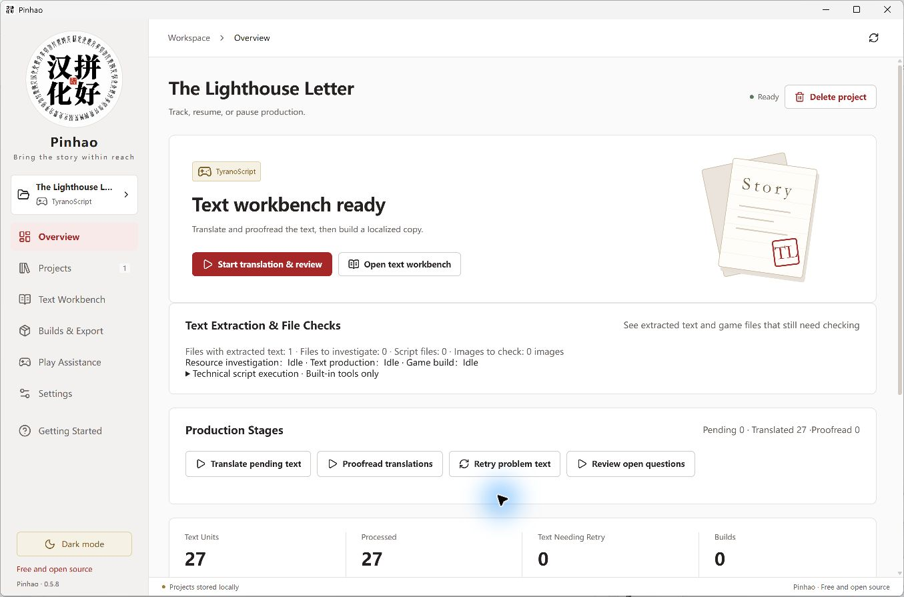
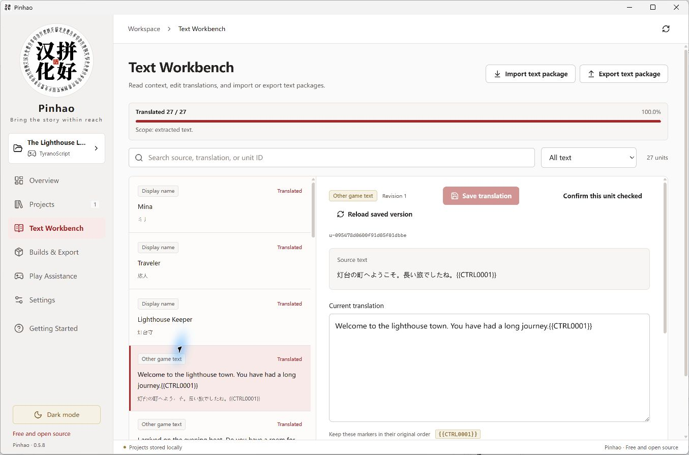
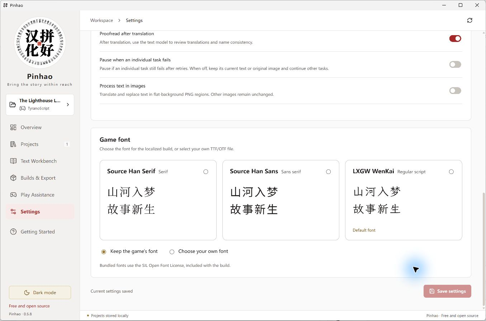
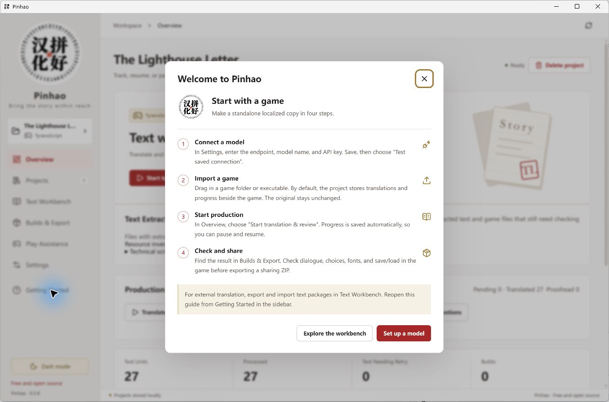

<p align="center">
  
</p>

<h1 align="center">Pinhao · 拼好汉化</h1>

<p align="center"><strong>Turn a game you love into a story you can read.</strong></p>

<p align="center">A Windows workbench for text extraction, AI translation and proofreading, fonts, and standalone localized games.</p>

<p align="center"><a href="README.md">中文</a> · English</p>

<p align="center">
  <a href="https://github.com/BlandaLin/pinhao/releases/tag/v0.5.8-en.1"><strong>Download English</strong></a> ·
  <a href="https://github.com/BlandaLin/pinhao/releases/tag/v0.5.8">中文版</a> ·
  <a href="#get-started">Get started</a> ·
  <a href="https://github.com/BlandaLin/pinhao/issues">Report an issue</a>
</p>

<p align="center">0.5.8 Public Beta · Windows 10 / 11 x64 · Free software; bring your own model API</p>



<p align="center"><sub>0.5.8 interface with an original sample project and prefilled translations.</sub></p>

## From One Game to a Workbench

While localizing games, I ran into text that existing tools could not extract. The rest of the work stopped with it. Pinhao brings extraction, technical investigation, translation, proofreading, and assembly into the same project.

- **Build a standalone localized copy.** Import a game, connect your model, translate, proofread, and build. The finished copy runs without Pinhao.
- **Investigate missing text.** Native parsers handle known formats. A technical Agent examines remaining resources, runs tools, and writes adapters. Text enters the workbench after its adapter passes the checks.
- **Keep and exchange your work.** Translations and progress stay on your computer. Edit them in the workbench, or export a text package for another AI tool or a human translator and import the results.

**Import → Extract → Translate and proofread → Build → Check in the game**

## Get Started

| Interface | Windows download | Default target for new settings |
| --- | --- | --- |
| English | [pinhao-0.5.8-en-Windows-x64.zip](https://github.com/BlandaLin/pinhao/releases/download/v0.5.8-en.1/pinhao-0.5.8-en-Windows-x64.zip) | English |
| 中文 | [pinhao-0.5.8-Windows-x64.zip](https://github.com/BlandaLin/pinhao/releases/download/v0.5.8/pinhao-0.5.8-Windows-x64.zip) | Simplified Chinese |

1. **Extract the whole archive and run `PinhaoWorkbench.exe`.** Use any writable folder. Keep the other files beside the executable.
2. **Connect a model in Settings.** Enter an OpenAI-compatible API endpoint, model name, and key; save and test the connection. Technical work and text work can use different models. Translation and proofreading share the text model. You can change the target language here.
3. **Drag in a game folder or executable.** Check the extracted text, then choose **Start translation & review**. Try a small project first to check the results and API costs.
4. **Generate a localized copy in Builds & Export.** Open it and check dialogue, choices, fonts, and save/load. Export a sharing ZIP when it is ready.

Settings and the project index live in `data` beside the app. Projects and localized copies default to folders beside the original game. Keep `data` and your project folders when updating. [Project storage](docs/product/PROJECT_STORAGE.md)

**Official builds are free. Do not pay to buy the official package. API costs follow your model provider's pricing.** You can also connect a compatible [local model server](docs/product/LOCAL_MODELS.md).

## Engines and Formats

The following engines have integrated extraction, writeback, and build tools. Custom plugins, resource formats, and encryption affect compatibility with individual games.

| Engine | Resources handled |
| --- | --- |
| RPG Maker MV / MZ | JSON data, bound script display text, fonts, and standalone assembly |
| RPG Maker XP / VX / VX Ace | Ruby Marshal data, RGSS scripts and archives |
| RPG Maker 2000 / 2003 | LCF data; Chinese builds use EasyRPG |
| WOLF RPG Editor | Archives, native WolfTL writeback, and font configuration |
| TyranoScript / KiriKiri KAG | Scenario scripts, display names, buttons, and supported ASAR / XP3 archives |
| Ren'Py | RPY, static RPYC recovery, RPA2 / RPA3 |
| Godot / Unity | Supported resource packs, scenes, scripts, and structured text resources |
| Pixel Game Maker MV / SMILE GAME BUILDER / RPG Developer Bakin | Integrated project formats, resource containers, and display-event text |

See [native engine routes](docs/product/NATIVE_ENGINES.md) and [implementation records](docs/product/IMPLEMENTATION.md) for individual formats.

## Translation, Proofreading, and the Text Workbench

Translation requests carry complete text units and available scene, character, and terminology references. Scene proofreading follows the first translation pass; the final terminology check handles actual disagreements. There is no separate full-glossary preparation pass before translation.

Search source text and translations, filter by status, jump to a page, and inspect context. **Reviewed** means the scene review has been saved. **Proofreading complete** means the final checks and submission have finished. Paused projects continue from saved progress.



ZIP text packages carry source text, translations, and scene references for external AI tools and human translators. On import, Pinhao checks revisions and flags conflicting edits. [Text packages](docs/product/TEXT_PACKAGE.md) · [Open read/write library](packages/exchange/README.md)

## Fonts and Play Assistance

- Use Source Han Serif, Source Han Sans, LXGW WenKai, the game's font, or your own TTF / OTF.
- Engine-specific play assistance includes characters, inventory, money, movement, switches, and variables. Gallery unlocks need the game's actual unlock conditions.
- RPG Maker MV / MZ builds can export JoiPlay `.rga` packages for mobile play.
- Optional image-text processing supports flat-background PNG regions.

<details>
<summary>Font settings and the first-launch guide</summary>





</details>

[Play assistance](docs/product/PLAY_ASSIST.md) · [Mobile play](docs/product/GAME_TYPES_AND_MOBILE.md)

## Technical Agent and Script Permissions

Technical tasks use [DeepSeek Harness](docs/product/DSH_RUNTIME.md) with the model you choose. The Agent reads resources, calls tools, writes adapters, and corrects them using validation results. Validated adapters stay with the project for reuse.

Script execution requires permission for each project. **Scripts run with your Windows user's file and network access.** The host keeps API keys and does not pass them to scripts. Pause a project before revoking permission. [Technical adaptation](docs/product/AUTONOMOUS_ADAPTATION.md)

## Beta Feedback

This version is in public beta. Complex plugins, encrypted resources, dynamic text, and font layout remain active areas of development. Keep the original game and saves, and check the result in the game.

Report issues in [GitHub Issues](https://github.com/BlandaLin/pinhao/issues) with the version, steps, error message, and relevant screenshots. For missing text, identify the dialogue or menu; for terminology, include a few lines of context. **Redact keys and personal information. Keep complete games, private projects, and saves out of public reports.**

[0.5.8 changes and known issues](docs/release-notes/v0.5.8.md#known-issues) · [English edition](docs/release-notes/v0.5.8-en.1.md) · [Contributing](docs/CONTRIBUTING.md)

## Development

The desktop uses Electron, TypeScript / React, and SQLite. Native codecs run in a separate Python process.

<details>
<summary>Run and package from source</summary>

On Windows, prepare Node.js 24.5+, npm, and Git:

```powershell
npm ci
npm run prepare:tools
npm run prepare:dsh -- --build
$env:PINHAO_UI_LANGUAGE = "en"
npm run build
npm run desktop
```

Keep the language variable set in the same PowerShell session when packaging. Clear it for the default Chinese build. New settings default to English or Simplified Chinese respectively; saved language choices are preserved.

```powershell
npm run check:public
npm test
npm run test:engines
npm run test:ui
npm run package
```

First setup downloads pinned tools and fonts. Compiling the managed bridge requires Windows .NET Framework 3.5; portable builds include compiled binaries. See the [desktop development guide](apps/desktop/README.md) for prerequisites and [GitHub Actions](https://github.com/BlandaLin/pinhao/actions/workflows/check.yml) for automated checks.

</details>

[Product and architecture](docs/product/README.md) · [Engine implementation](docs/product/IMPLEMENTATION.md) · [Contribution guide](docs/CONTRIBUTING.md)

## License and Sharing

The desktop uses [GPL-3.0-or-later](LICENSE); the standalone text-package library uses [MIT](packages/exchange/LICENSE). Fonts and third-party components retain their own licenses. Game resources, translations, and assets follow their respective permissions.

Share the [official repository](https://github.com/BlandaLin/pinhao) and download links. Official builds are free.
