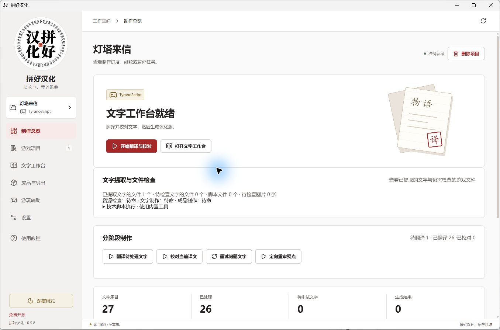
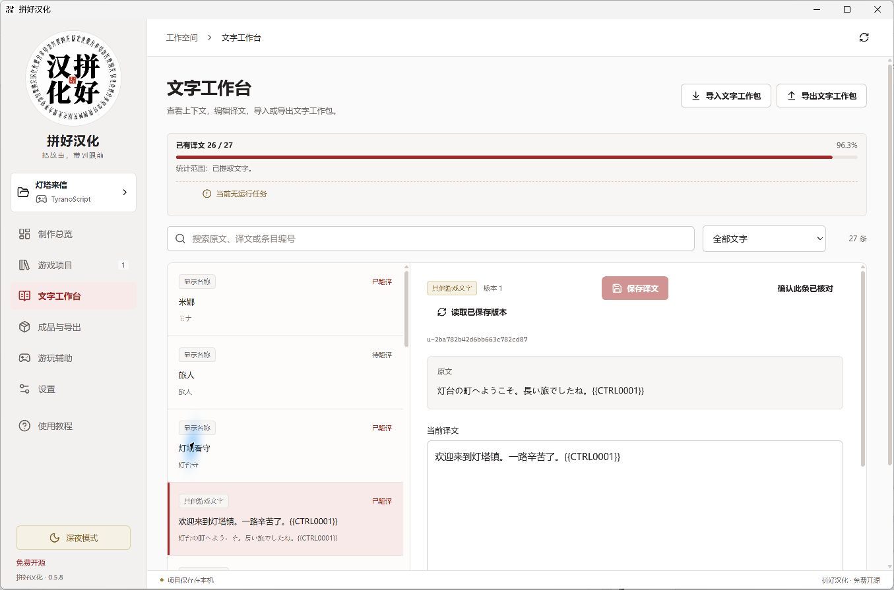
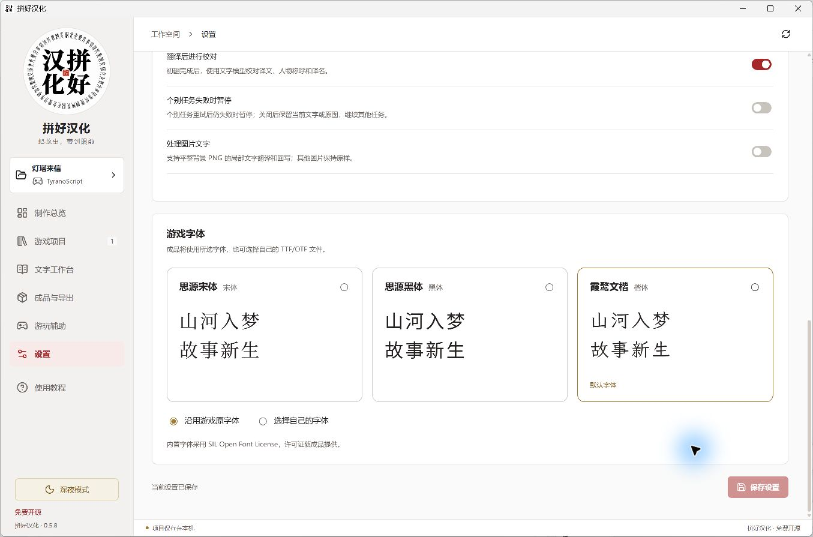
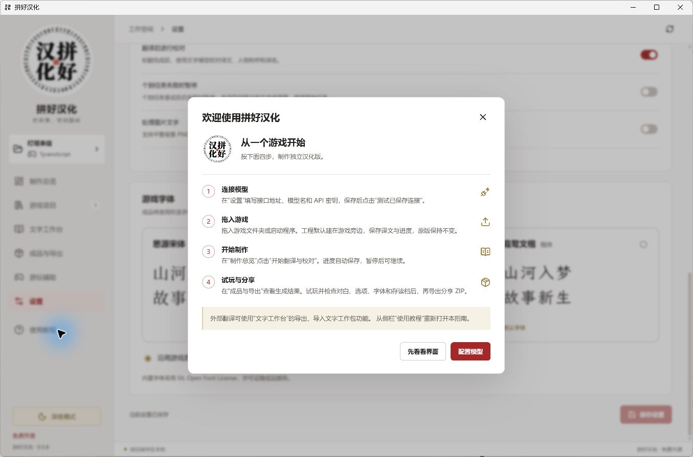

<p align="center">
  
</p>

<h1 align="center">拼好汉化 · Pinhao</h1>

<p align="center"><strong>把喜欢的游戏，做成读得懂的故事。</strong></p>

<p align="center">Windows 游戏翻译工作台：提取文字、AI 翻译与校对、字体设置、独立成品。</p>

<p align="center">中文 · <a href="README.en.md">English</a></p>

<p align="center">
  <a href="https://github.com/BlandaLin/pinhao/releases/tag/v0.5.8"><strong>下载中文版</strong></a> ·
  <a href="https://github.com/BlandaLin/pinhao/releases/tag/v0.5.8-en.1">Download English</a> ·
  <a href="#开始使用">开始使用</a> ·
  <a href="https://github.com/BlandaLin/pinhao/issues">反馈问题</a>
</p>

<p align="center">0.5.8 公开测试版 · Windows 10 / 11 x64 · 软件免费，自备模型 API</p>



<p align="center"><sub>当前源码构建界面，使用自写示例工程与预先填写的译文。</sub></p>

## 从一款游戏开始

我做游戏汉化时，遇到过现成工具提不出文字、后续工作也跟着停下来的情况。拼好把提取、技术调查、翻译校对和成品制作放到一起，让这些工作在同一个项目里继续。

- **制作独立汉化版。** 导入游戏，连接自己的模型，完成翻译、校对与构建。成品是独立游戏目录，游玩时无需运行拼好。
- **调查漏提文字。** 原生解析器处理已知格式，技术 Agent 检查剩余资源、运行工具并编写适配方案，通过检查的文字接入工作台。
- **保留并交换成果。** 译文和进度保存在本地。你可以直接修改译文，也可以导出文字工作包，交给其他 AI 工具或译者处理后再导回。

**导入游戏 → 提取文字 → 翻译与校对 → 生成成品 → 打开游戏检查**

## 开始使用

| 界面版本 | Windows 下载 | 新配置的默认翻译目标 |
| --- | --- | --- |
| 中文 | [pinhao-0.5.8-Windows-x64.zip](https://github.com/BlandaLin/pinhao/releases/download/v0.5.8/pinhao-0.5.8-Windows-x64.zip) | 简体中文 |
| English | [pinhao-0.5.8-en-Windows-x64.zip](https://github.com/BlandaLin/pinhao/releases/download/v0.5.8-en.1/pinhao-0.5.8-en-Windows-x64.zip) | 英语 |

1. **完整解压，运行 `PinhaoWorkbench.exe`。** 软件可以放在任意可写目录，不要只取出 EXE。
2. **在“设置”连接模型。** 填写 OpenAI 兼容服务的 API 地址、模型名和密钥，保存后测试连接。技术任务与文字任务可使用不同模型；翻译和校对共用文字模型。目标语言也在这里修改。
3. **拖入游戏目录或启动程序。** 查看提取的文字，点击“开始翻译与校对”。先用小项目确认效果和费用。
4. **在“成品与导出”生成汉化版。** 打开成品检查对白、选项、字体和存读档，确认后导出分享 ZIP。

设置和项目索引保存在程序旁的 `data` 文件夹；工程与成品默认放在原游戏旁边。更新程序时保留 `data` 和工程目录。[文件存储说明](docs/product/PROJECT_STORAGE.md)

**官方软件免费，请勿付费购买官方包。模型请求的费用由所选服务商收取。** 也可连接兼容 API 的[本地模型](docs/product/LOCAL_MODELS.md)。

## 引擎与格式

以下引擎已接入提取、回写和成品处理工具。自定义插件、特殊资源和加密方式会影响具体游戏的处理结果。

| 引擎 | 处理内容 |
| --- | --- |
| RPG Maker MV / MZ | JSON 数据、已绑定的脚本显示文字、字体与独立成品 |
| RPG Maker XP / VX / VX Ace | Ruby Marshal 数据、RGSS 脚本及归档 |
| RPG Maker 2000 / 2003 | LCF 数据；中文成品使用 EasyRPG |
| WOLF RPG Editor | 归档、WolfTL 文字回写与字体配置 |
| TyranoScript / KiriKiri KAG | 场景脚本、显示名、按钮及支持的 ASAR / XP3 归档 |
| Ren'Py | RPY、RPYC 静态恢复、RPA2 / RPA3 |
| Godot / Unity | 支持的资源包、场景、脚本与结构化文字资源 |
| Pixel Game Maker MV / SMILE GAME BUILDER / RPG Developer Bakin | 已接入的项目格式、资源容器与显示事件文字 |

各格式的处理范围见[原生引擎说明](docs/product/NATIVE_ENGINES.md)和[实现记录](docs/product/IMPLEMENTATION.md)。

## 翻译、校对与文字工作台

翻译按完整语义单元组织，附带已有的场景、人物和术语参考。初翻后进行场景校对，最后处理实际存在的译名分歧；译名整理不再是开工前的一整轮付费任务。

文字工作台可搜索原文和译文、按状态筛选、输入页码跳转，并查看上下文。“已审阅”表示场景校对结果已保存；“校对已完成”表示收尾检查和提交已结束。暂停后从保存的进度继续。



导出的 ZIP 文字工作包包含原文、译文和场景参考，可交给外部 AI 或人工处理。回导时核对版本并提示修改冲突。[工作包说明](docs/product/TEXT_PACKAGE.md) · [开放读写库](packages/exchange/README.md)

## 字体与游玩辅助

- 内置思源宋体、思源黑体和霞鹜文楷，也可使用游戏原字体或自己的 TTF / OTF。
- 游玩辅助按引擎提供角色、物品、金钱、移动、开关和变量编辑；回想解锁需要找到对应游戏的解锁条件。
- RPG Maker MV / MZ 成品可导出 JoiPlay `.rga` 手机游玩包。
- 可选图片文字处理支持平整背景 PNG 区域。

<details>
<summary>查看字体设置与首次使用指南</summary>





</details>

[游玩辅助说明](docs/product/PLAY_ASSIST.md) · [手机游玩说明](docs/product/GAME_TYPES_AND_MOBILE.md)

## 技术 Agent 与执行权限

技术任务使用 [DeepSeek Harness](docs/product/DSH_RUNTIME.md)，模型由你选择。Agent 读取资源、调用工具、编写适配器，并根据检查结果修正；已通过检查的适配结果保存在项目中供后续复用。

启用技术脚本需要按项目授权。**脚本以当前 Windows 用户权限访问文件和网络。** API 密钥由主程序保管，不传给脚本；授权可在暂停后撤销。[技术适配说明](docs/product/AUTONOMOUS_ADAPTATION.md)

## 公测与反馈

当前版本仍在公测。复杂插件、加密资源、动态文字和字体布局是重点改进范围。请保留原游戏与存档，并在成品中检查实际显示。

遇到问题，请在 [Issues](https://github.com/BlandaLin/pinhao/issues) 提供版本、操作步骤、错误提示和相关截图。漏字时指出具体对白或菜单；译名问题附几句上下文即可。**遮盖密钥和个人信息，不要公开上传整款游戏、私人工程或存档。**

[0.5.8 更新与已知问题](docs/release-notes/v0.5.8.md#known-issues) · [英文版说明](docs/release-notes/v0.5.8-en.1.md) · [反馈与贡献](docs/CONTRIBUTING.md)

## 开发

桌面端使用 Electron、TypeScript / React 和 SQLite；原生编解码器由 Python 进程调用。

<details>
<summary>从源码运行与打包</summary>

Windows 上准备 Node.js 24.5+、npm 和 Git：

```powershell
npm ci
npm run prepare:tools
npm run prepare:dsh -- --build
npm run build
npm run desktop
```

英文构建在同一 PowerShell 会话中先设置 `$env:PINHAO_UI_LANGUAGE = "en"`，再执行 `npm run build` 和 `npm run package`；中文构建清除该环境变量。两者分别为新配置提供英语、简体中文的翻译目标，保留已有语言选择。

```powershell
npm run check:public
npm test
npm run test:engines
npm run test:ui
npm run package
```

首次准备会下载固定版本的工具与字体。编译托管桥需要 Windows .NET Framework 3.5；便携包已包含编译结果。完整环境说明见[桌面开发文档](apps/desktop/README.md)。自动检查的已知失败及测试记录见[发布说明](docs/release-notes/v0.5.8.md#known-issues)。

</details>

[产品与架构](docs/product/README.md) · [引擎实现记录](docs/product/IMPLEMENTATION.md) · [贡献指南](docs/CONTRIBUTING.md)

## 许可与分享

主程序采用 [GPL-3.0-or-later](LICENSE)，独立文字工作包库采用 [MIT](packages/exchange/LICENSE)。内置字体和第三方组件保留各自许可证。游戏、译文和素材的使用与分发遵循各自授权。

欢迎分享[官方仓库](https://github.com/BlandaLin/pinhao)和下载地址。官方软件免费提供。
