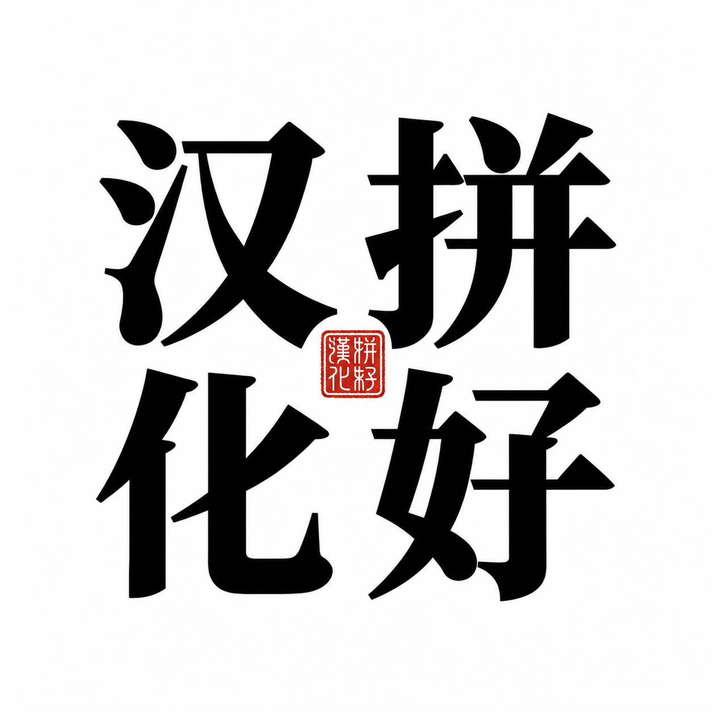
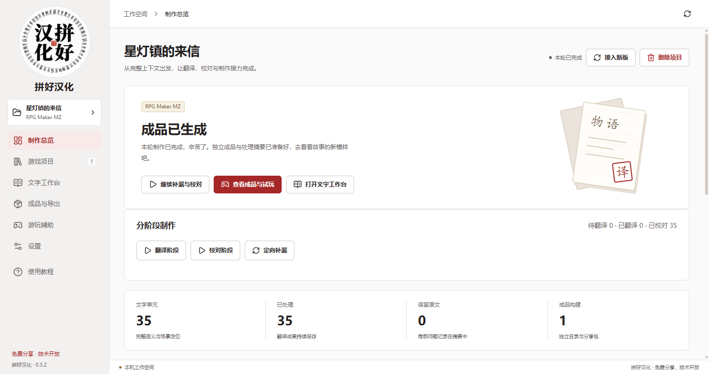
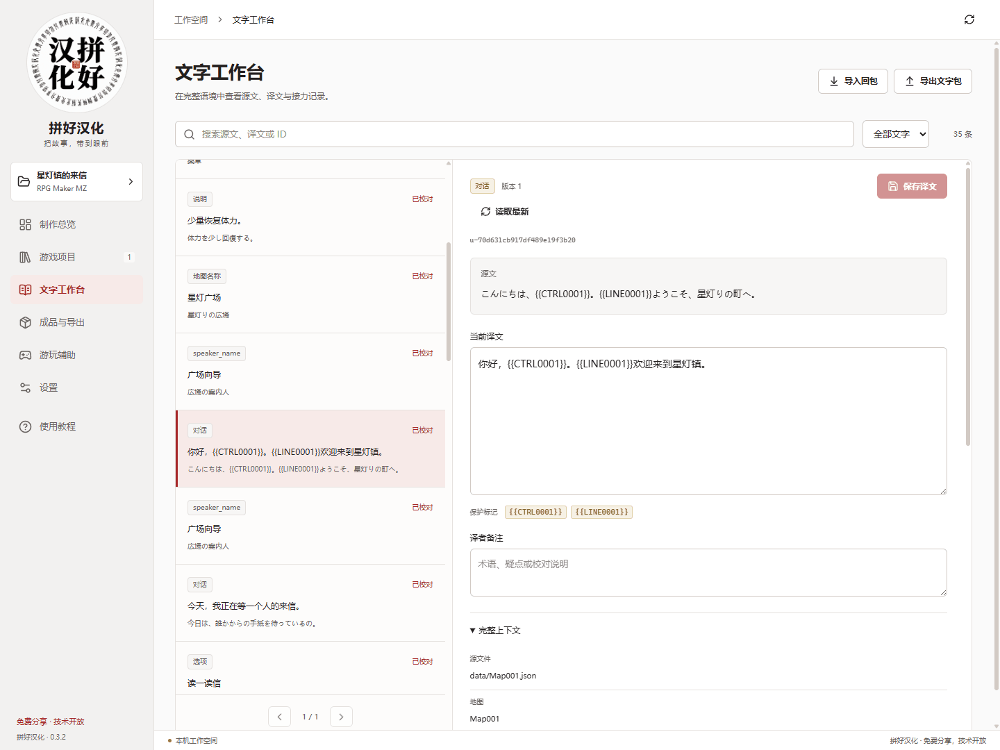
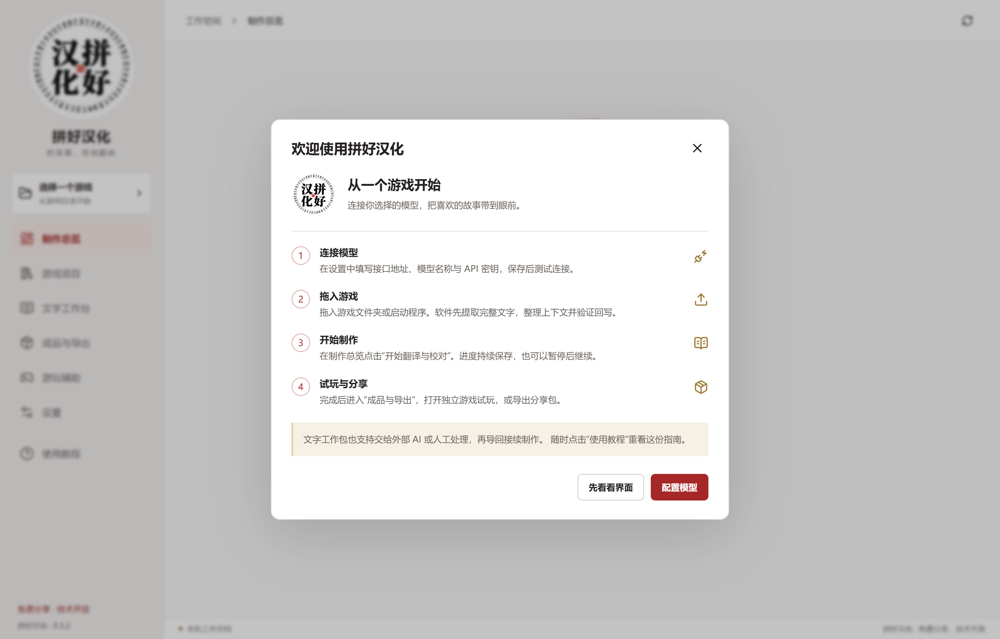
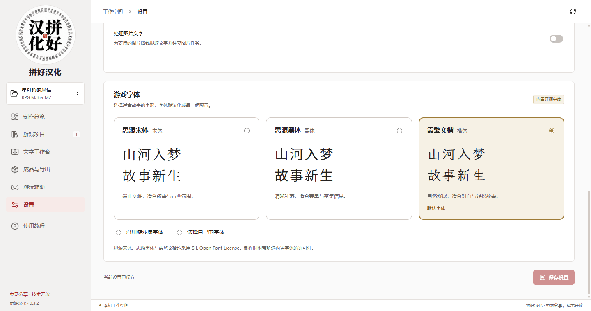
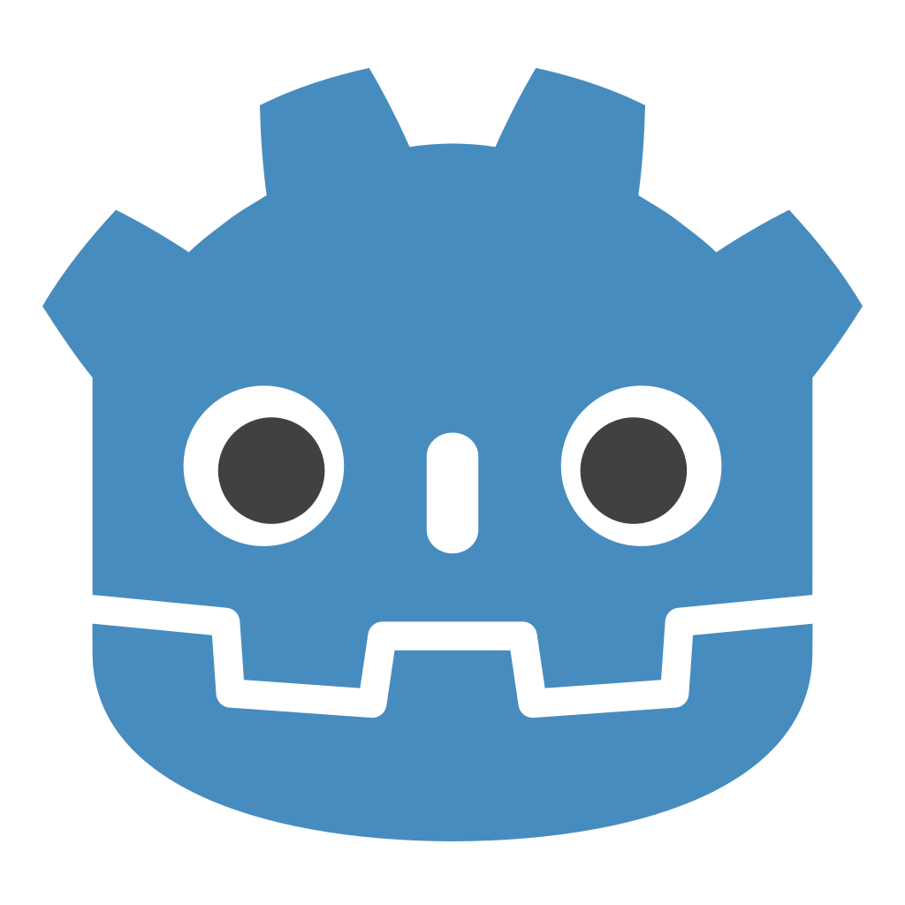

<p align="center">
  
</p>

<h1 align="center">拼好汉化 · Pinhao</h1>

<p align="center"><strong>把喜欢的游戏，做成读得懂的故事。</strong></p>

<p align="center">
  Windows 游戏汉化工作台 · Agent 分工协作 · 开放文字工作包 · 独立汉化成品
</p>

<p align="center">
  中文 · <a href="README.en.md">English</a>
</p>

<p align="center">
  <a href="https://github.com/BlandaLin/pinhao/releases/tag/v0.5.8"><strong>下载 0.5.8 Windows 便携版</strong></a> ·
  <a href="#开始你的第一个项目">开始使用</a> ·
  <a href="#引擎覆盖">引擎覆盖</a> ·
  <a href="docs/CONTRIBUTING.md">反馈与贡献</a>
</p>

<p align="center">
  <strong>0.5.8 公开测试版</strong> · Windows 10 / 11 x64 ·
  <a href="LICENSE">GPL-3.0-or-later</a> · 官方免费
</p>

**公测说明：** 已接入多类引擎的资源处理路线，不代表每一款游戏都能完整汉化。自定义插件、加密资源、动态文字与字体布局仍需按游戏检查。请保留原版和存档，先用短场景确认效果。

**官方软件免费，切勿付费购买官方包。** 模型 API 费用由你选择的服务商收取；也可接入本地兼容服务。[查看 0.5.8 更新说明](docs/release-notes/v0.5.8.md)。



<p align="center"><sub>当前桌面界面，原创中性示例项目；模型环节采用本地演示数据。</sub></p>

## 从喜欢一款游戏开始

一款游戏吸引你的，也许是它的世界、角色，或者一个想亲自走到结尾的故事。
汉化让这些故事来到眼前：名字前后一致，台词接得上语境，翻译完成后，打开游戏就能继续冒险。

拼好汉化从实际游戏汉化的工作中生长出来，把引擎适配、文字整理、翻译校对和成品制作连成一条流程。
**选好游戏，接入自己的模型，得到一份可以独立运行的汉化版。**

| 你关心的事 | 拼好的做法 |
| --- | --- |
| 台词连着故事 | 按完整语义提取，保留说话人、场景位置、相邻文本与共享专名词表。 |
| 工作交给合适的人 | 技术与文字模型按阶段接力，可共用或分别配置；翻译与校对共用文字模型。 |
| 成果带得走 | 开放 ZIP 文字工作包连接软件、外部 Harness 与人工；成品输出为独立游戏目录和分享 ZIP。 |

**导入游戏 → 提取与技术补漏 → 翻译与校对 → 字体与成品制作 → 检查后游玩**

## 0.5.8：让每一轮工作接得上

已接受的翻译持续保存，暂停后沿用当前进度。翻译与校对可以按需补查项目原文，
把有依据的人物、义项与术语决定保存在对应范围。校对逐条审阅，只返回实际修订，准确的句子保持原样。
初翻直接从正文开始，译名随译文一起积累；软件在初翻后汇总独立出处，把有分歧的译名带入正常校对，不另开付费词表整理阶段。

技术 Agent 取得完整工具证据，申请关联资源范围，验证改文并复用配方。
构建问题携带实际失败工件回到技术处理；成品内容、字体覆盖和运行观察分别记录。

[文字接力与恢复协议](docs/product/TEXT_EXECUTION.md) · [本次更新](docs/release-notes/v0.5.8.md)

## 技术 Agent 自主适配

技术执行默认使用 **DeepSeek Harness**，模型由你配置，不要求使用 DeepSeek 模型。
引擎识别、解包、零文字和资源覆盖缺口进入持久技术任务。Agent 查看资源、检索公开技术资料、
调用已安装工具，编写适配器，并依据真实错误继续修复。通过原样往返、结构与控制符检查、改文回读的配方，
接回现有文字工作台和独立成品流程；再次导入时复用配方并核对新的资源基线。

轻量 JavaScript 配方运行于 **QuickJS WASM**，通过主程序提供的能力读取游戏工作副本、写入指定输出。
需要新解析办法时，技术 Agent 可编写脚本并使用受管本地执行；首次启用需为当前项目授权。
脚本以当前 Windows 用户权限运行，可以访问该用户的文件及网络；模型密钥由主程序保管，产品不向脚本传入密钥。
技术任务与翻译、校对共享并发设置，支持暂停、恢复和有限修复。
资源覆盖、文字进度与实际运行检查分别展示。
侧栏提供日间与深夜模式切换，主题选择随下次启动恢复。

[自主适配协议与验证](docs/product/AUTONOMOUS_ADAPTATION.md) · [DSH 技术运行时](docs/product/DSH_RUNTIME.md)

## 文字工作，连着上下文

工作台先完成文字提取和原样回写检查，再把材料交给翻译与校对。
文字单元带着稳定 ID、源文、当前译文和引擎提供的上下文一起流转；同一份人名与术语参考贯穿整个项目。

你可以在文字工作台里搜索、审阅和修订，也可以把工作包交给自己熟悉的 AI 工具或其他译者。
回包时，程序核对来源、控制符与版本基线，将新成果合并回当前项目。



### 一个可以接力的文字工作包

**材料一起交出去，成果一起带回来。** ZIP 里有阅读说明、场景参考、术语、当前译文和编辑入口。
翻译、校对与润色可以由不同的人或模型接手，已接受的成果持续保留。

<details>
<summary>看看工作包里有什么</summary>

```text
文字工作包.zip
├── START_HERE.md        阅读入口与交付方式
├── manifest.json        包身份、格式与文件摘要
├── source/              完整源文与稳定 ID
├── context/             场景与上下文参考
├── baseline/            导出时的译文版本
├── editable/            JSON 或纯文字编辑入口
├── reading/             便于通读的场景视图
├── glossary.json        共享专名与术语
├── style-guide.md       文字风格约定
└── issues.json          待确认问题
```

当前导出格式为 **PinHao Text Package 0.2**，仍可导入旧 0.1 完整包。目标与只读参考分开，并明确初翻或校对阶段。纯文字模式填写 `TEXT`、`NOTE` 与提交意图；
JSON 模式填写译文、备注与提交意图。程序使用稳定 ID 定位，并以三方合并处理版本变化。

[格式与参考实现](packages/exchange/README.md) · [文字工作包设计](docs/product/TEXT_PACKAGE.md)

</details>

## 开始你的第一个项目

准备 **Windows 10 / 11 x64**、一个游戏目录，以及自己的模型接口。
当前桌面界面为中文，项目首页提供中英文说明。

1. **打开工作台。** 从 [0.5.8 下载页](https://github.com/BlandaLin/pinhao/releases/tag/v0.5.8) 获取 Windows 便携包，完整解压到可写目录，启动 `PinhaoWorkbench.exe`。
2. **接好模型。** 在“设置”填写 OpenAI-compatible 接口地址、模型名称和密钥。技术与文字工作可分别选用模型，翻译与校对沿用同一文字连接。
3. **放入游戏，开始制作。** 拖入游戏文件夹、启动程序或 Windows 快捷方式，查看提取结果与待处理项，再启动制作流程；外部译文通过文字工作包接力。
4. **检查成品，继续冒险。** 从“成品与导出”启动独立汉化版，检查对话、选项、字体和存读档；需要分享时再导出 ZIP。

**工程就近保存。** 软件配置与索引放在便携目录的 `data`，游戏工程默认建在原游戏旁边，使用可辨认的“游戏名-拼好工程”名称，独立成品也默认放在旁边。只按工具实际需要准备工作资源，不为每个 Agent 预先复制整款游戏；普通请求不再重复保存网络流、推理和解析译文。详见[工程与磁盘存储](docs/product/PROJECT_STORAGE.md)。

**先用少量文字试做，再决定是否批量运行。** 翻译、校对与技术模型请求均可能产生 API 费用；实际速度、质量和成本取决于游戏、模型及服务商。
本地模型通过 OpenAI-compatible 服务接入，Qwen 接入示例见[本地模型说明](docs/product/LOCAL_MODELS.md)。

<details>
<summary>首次使用的四步引导</summary>



侧栏“使用教程”随时打开引导。制作期间，界面显示当前阶段与进度，已接受成果持续保存。
翻译、校对和定向补漏也各有独立入口。

</details>

## 为故事挑一副字形

内置 **思源宋体、思源黑体、霞鹜文楷**，字体选项直接展示各自的字形。
你也可以沿用游戏字体，或选用自己的 TTF / OTF 文件；所选内置字体及其许可证随成品提供。



游玩辅助按引擎提供角色、物品、金钱、移动探索、回想条件分析与变量编辑等入口。
MV / MZ 成品还可导出 JoiPlay `.rga` 手机游玩包。

[游玩辅助与引擎能力](docs/product/PLAY_ASSIST.md) · [手机游玩与设备检查](docs/product/GAME_TYPES_AND_MOBILE.md)

## 引擎覆盖

<p>
   &nbsp;
   &nbsp;
   &nbsp;
  
</p>

**RPG Maker 是主力路线。** 同人 RPG、SLG 和 ADV 的适配依据实际引擎与资源格式展开：

| 引擎 | 当前接入的资源路线 |
| --- | --- |
| **RPG Maker MV / MZ** | JSON 数据、已绑定的 JavaScript 显示文字、字体与独立组装。 |
| **RPG Maker XP / VX / VX Ace** | Ruby Marshal 数据、RGSS 归档、脚本容器与本地化模块。 |
| **RPG Maker 2000 / 2003** | LCF 原生数据；中文成品携带 EasyRPG 运行器与字体。 |
| **WOLF RPG Editor** | 归档提取、WolfTL 原生回写、字体配置与独立组装。 |
| **TyranoScript / KiriKiri KAG** | KS 场景、显示名与按钮，标准 ASAR、raw / zlib XP3 及相应内嵌归档。 |
| **Ren'Py** | RPY、RPYC 静态恢复、RPA2 / 3，覆盖对白、选项、人物名、UI 与字体。 |
| **Godot 2 / 3 / 4** | PCK 与内嵌包、已接入的编译场景与 GDScript、翻译目录与字体。 |
| **Pixel Game Maker MV** | 标准及已接入加密项目的文字、字体绑定与资源重建。 |
| **SMILE GAME BUILDER / RPG Developer Bakin** | 原生目录与资源容器、显示事件文字、字体及原运行器组装。 |
| **Unity** | SerializedFile / UnityFS、结构化 TextAsset、已确认 UI / TMP 字段、StringTable 与内嵌动态字体。 |

把手头的游戏拖入工作台，即可查看引擎识别、文字提取与项目检查结果。
每个项目记录探测到的能力、构建检查和待处理项。引擎矩阵列出格式覆盖与实际运行证据；
具体游戏的自定义插件、加密资源和字体布局按项目适配。检测到引擎、提取出文字、通过原生回写和实际可玩是不同的检查项，不能相互替代。

[实现与验证矩阵](docs/product/IMPLEMENTATION.md) · [原生引擎路线](docs/product/NATIVE_ENGINES.md)

## 每次更新，接着已有成果继续

项目保存当前译文与历史修订。游戏更新后，“接入新版”建立独立项目，
复用源文与上下文匹配的已有译文，把后续工作集中到新增和变化的内容。

日常制作同样可以分阶段进行：先翻译，再校对，最后定向补漏。
可选图片处理将识别出的文字送入同一队列，当前回写覆盖平整背景 PNG 区域。

## 一起把汉化做得更好

拼好希望把技术、工具和文字成果交到更多玩家手里。
你可以用它完成自己的第一个汉化项目，也可以把适配经验、术语和改进带回开源社区。

- **使用者**：在 [Issue](https://github.com/BlandaLin/pinhao/issues) 分享问题、界面截图和期望效果。
- **译者与制作者**：交换文字工作包，改进术语、校对流程和实际游戏体验。
- **开发者**：参与引擎适配、界面、测试、文档和工作包生态。
- **支持这个方向**：收藏项目、分享官方地址，帮助更多同好找到它。

[反馈与贡献指南](docs/CONTRIBUTING.md)提供问题模板、最小样例和提交方式。
反馈时请隐去密钥、个人目录与私人存档，使用获得授权的样例材料。

## 开发与资料

项目采用 **Electron + TypeScript / React + SQLite**，通过 Python 复用原生编解码器。
DSH 技术 Agent 运行适配工具与验证修复循环，翻译和校对使用独立的文字协议，任务队列负责保存与恢复。

<details>
<summary>从源码运行与打包</summary>

在 Windows 上准备 **Node.js 24.5+**、npm 和 Git：

```powershell
npm ci
npm run prepare:tools
npm run prepare:dsh -- --build
npm run build
npm run desktop
```

`prepare:tools` 下载并核验固定版本的 Python、字体与原生工具。`prepare:dsh -- --build` 准备并编译固定版本的 DSH 运行时；首次准备需要网络。固定版本、依赖管理和载荷说明见 [DSH 技术运行时](docs/product/DSH_RUNTIME.md)。
源码构建旧版托管桥需要 Windows 的 **.NET Framework 3.5** 功能；便携版已携带编译好的桥。

按需运行本地检查：

```powershell
npm test
npm run test:engines
npm run test:ui
```

`test:engines` 还需可用的 Python。上述组件测试使用中性样例或本地模拟端点，不替代真实模型、实际游戏与干净机器验收。

```powershell
npm run package
```

发行目录生成在 `local/releases/<版本>/PinhaoWorkbench-win32-x64/`。
基础 CI 使用 `npm run build`、`npm run check:public`、`npm run test:ci` 与 `npm run test:ui`。
测试使用中性样例和本地模拟模型端点。

[桌面开发说明](apps/desktop/README.md)提供完整依赖与打包步骤。

</details>

| 入口 | 内容 |
| --- | --- |
| [产品与架构](docs/product/README.md) | 产品定义、分工与实现路线 |
| [桌面使用与开发](apps/desktop/README.md) | 安装、模型、字体、辅助与源码运行 |
| [开放文字工作包](packages/exchange/README.md) | 格式、schema 与 MIT 参考读写库 |
| [工程经验](docs/工程经验.md) | 回包、补漏、排版、存档与发布实践 |
| [实现与验证](docs/product/IMPLEMENTATION.md) | 引擎能力、实际检查与后续适配 |

## 许可与分享

**官方软件免费，技术开放；切勿付费购买官方包。** 欢迎分享官方发布地址，项目接受贡献、赞助与支持。

桌面程序与产品模块采用 [GPL-3.0-or-later](LICENSE)，开放文字读写库采用
[MIT](packages/exchange/LICENSE)，便于其他软件接入。允许依许可证进行商业使用；
分发 GPL 改版时提供相应源码。内置字体采用 SIL Open Font License，第三方组件保留各自许可证。

游戏资源、译文与分享行为遵循各自授权。

